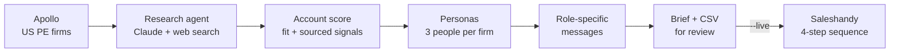

# Account-Based GTM for AI Agents in Private Markets

A go-to-market engine for a company selling AI agents to US private equity
firms. An AI research agent studies each firm on the web, scores the account
on real, sourced buying signals, picks the right people by role, and writes
outreach that pitches each person the agent that solves *their* problem.

> **Case study.** "Acme Agents" is a placeholder product; set your own in
> `config/icp.yaml`. The sample accounts are fictional.

## The problem

Selling to private equity is different from selling to SMBs:

- **The market is small and high-value.** There are a few thousand US PE
  firms, and one closed deal can be a six-figure contract. Mass email burns
  the market; every account needs research.
- **One firm, many buyers.** A Managing Partner cares about deal flow, an
  Associate about the hours from CIM to IC memo, an Operating Partner about
  the portfolio, a Head of Data about security. One generic email fits none.
- **Timing matters.** A firm that just closed a fund, made a platform
  acquisition or hired a Head of Data is far more likely to buy now.

Doing this research well by hand can easily take an SDR most of an hour per firm.

## The approach



1. **Account sourcing.** Apollo organization search for US private equity
   firms with 11-500 employees.
2. **Research agent.** Claude Opus 5.5 uses web search and web fetch to read
   the firm's site and recent news, then produces a structured brief: strategy,
   sectors, check size, latest fund, and signals from the last 18 months
   (fund closes, platform deals, add-ons, exits, key hires, AI initiatives).
   **Every signal must cite a source URL**; anything unverified is listed
   under "Could not verify".
3. **Account scoring (0-100).** 60% Claude's fit assessment, plus 10 points
   per *sourced* signal (max 3) and 10 for core-segment firms. Unsourced
   claims earn nothing.
4. **Persona mapping.** Up to three contacts per firm, one per buying role,
   each matched to the most relevant agent:

   | Persona | Example titles | Agent pitched | Pain addressed |
   |---|---|---|---|
   | Deal team leadership | Managing Partner, Partner | Deal Sourcing Agent | Seeing targets before a banker-run process |
   | Deal execution | VP, Senior Associate | Diligence Agent | Hours from CIM to first IC memo |
   | Portfolio operations | Operating Partner | Portfolio Monitoring Agent | Plan vs. actual, bolt-on pipeline |
   | Business development | Head of Origination | Deal Sourcing Agent | Market coverage without headcount |
   | Technology and AI | CTO, Head of Data | Secure AI platform | AI rollout without data risk |

   Matching uses the longest matching title, so "Operating Partner" is routed
   to portfolio operations, not deal leadership.
5. **Messaging.** Claude writes a subject, opening line (from a sourced
   signal) and agent pitch for each contact, using the brief.
6. **Review, then send.** Every run saves a one-page brief per firm and a
   contacts CSV. Contacts go to a 4-step Saleshandy sequence only with `--live`.

**See the output:** [examples/sample_account_brief.md](examples/sample_account_brief.md)

## Quick start

```bash
pip install -r requirements.txt
python main.py demo                 # fictional accounts, no API keys needed
python -m unittest discover -s tests -t .
```

## Running it for real

1. `cp .env.example .env` and add your Apollo, Anthropic and Saleshandy keys.
2. Create the sequence from [templates/sequence.md](templates/sequence.md) in
   Saleshandy, with custom fields `first_line`, `agent_pitch` and
   `firm_insight`. Copy the Step 1 ID into `SALESHANDY_STEP_ID`.
3. Run `python main.py fields` and paste the field IDs into `config/icp.yaml`.
4. Set your product name and facts in `config/icp.yaml`.

```bash
python main.py run --accounts 3     # research 3 firms, save briefs + CSV
python main.py run --live           # also add contacts to Saleshandy
```

**Costs per firm:** Apollo enrichment for up to 3 contacts, plus one research
run (Claude with up to 6 web searches and 4 page fetches) and two short Claude
calls. Start with `--accounts 3` to check the quality and cost.

## Project layout

| File | Purpose |
|---|---|
| `config/icp.yaml` | Target firms, personas, agent mapping, product facts |
| `gtm/research.py` | Research agent, brief structuring, message writing |
| `gtm/scoring.py` | Account score and persona matching |
| `gtm/apollo.py` | Firm search, people search, enrichment |
| `gtm/saleshandy.py` | Sequence import |
| `gtm/render.py` | One-page Markdown account brief |
| `gtm/pipeline.py` | The full run, plus the keyless demo |
| `templates/sequence.md` | 4-step email sequence |

## Design choices

- **Account-based, not volume.** A small market rewards depth: a few
  researched accounts a day beat thousands of generic emails.
- **Sources or it didn't happen.** Signals without a URL don't score, and
  the brief lists what couldn't be verified, so reps never open with a
  wrong fact about a firm.
- **Human review by default.** Briefs and CSVs are written first; sending is
  an explicit `--live` step.
